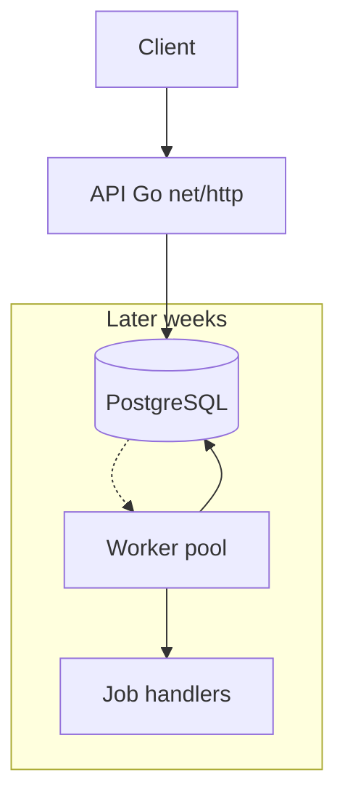
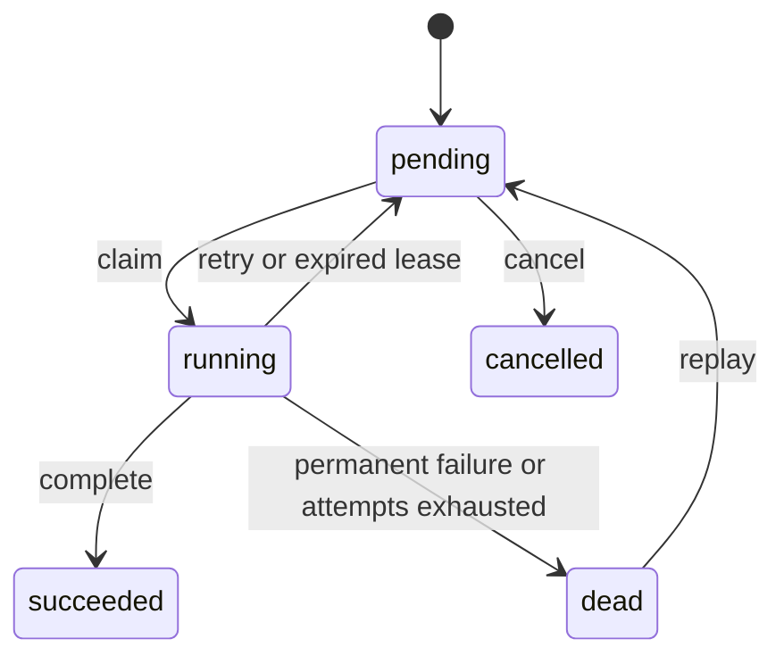

# Architecture (Week 1)

Arden is a distributed job platform. PostgreSQL is the source of truth and the coordination layer. Workers are not implemented in Week 1; the API persists jobs and the schema already enforces the lifecycle workers will use.

## Flow

Week 2 adds workers that claim pending rows inside transactions (`FOR UPDATE SKIP LOCKED`), set a lease, and increment the fencing token.

## Tables

| Table | Role |
| --- | --- |
| `jobs` | Definition, status, lease, fencing token, idempotency key |
| `job_attempts` | One row per claim (`job_id`, `fencing_token` unique) |
| `workers` | Registration and heartbeats |
| `job_schedules` | Cron definitions; Week 6 materializes occurrences into `jobs` |

## Job lifecycle

Database triggers reject transitions outside this graph. A `running` job must have `lease_owner` and `lease_expires_at`; other statuses must not.

## Delivery semantics

Execution is **at-least-once**, not exactly-once. Handlers must be idempotent. The fencing token invalidates a stale worker’s completion after its lease expires. Client submission deduplication uses `Idempotency-Key` on the API.

See [adr/](adr/) for decisions.

## API (Week 1)

| Method | Path | Purpose |
| --- | --- | --- |
| `POST` | `/v1/jobs` | Create (optional `Idempotency-Key`) |
| `GET` | `/v1/jobs/{id}` | Fetch one |
| `GET` | `/v1/jobs` | List (`status`, `queue`, cursor) |
| `POST` | `/v1/jobs/{id}/cancel` | Cancel pending |
| `GET` | `/healthz` | Liveness |
| `GET` | `/readyz` | DB connectivity |
